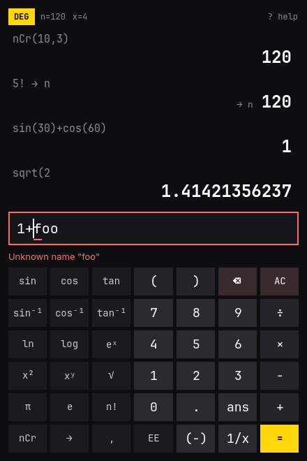

# scicalc



A keyboard-first scientific calculator for one-off sums on Omarchy, in the
spirit of a TI-83/84 home screen: type a line, press Enter, and the answer
stacks up under the last one. It opens in a few milliseconds, floats in the
middle of the screen, follows the Omarchy theme accent, and remembers its
history, variables, and angle mode between runs.

## Writing expressions

| Example | Meaning |
|---|---|
| `2pi`, `3(4+1)`, `2sin(30)` | Multiplication can be implied |
| `*2`, `^2`, `!` | A leading operator continues from `ans` |
| *(empty)* Enter | Repeat the last entry (`ans+1`, Enter, Enter…) |
| `x = 5`, `5→x`, `5 -> x` | Store a variable |
| `2^10`, `2**10`, `3²` | Powers; `-2^2` is `-4` |
| `7 % 3`, `mod(7,3)` | Remainder (sign follows the divisor) |
| `1.5e3` | Scientific notation |
| `0xff`, `0b101`, `0o17` | Hex, binary, and octal numbers |
| `sin(30` | Closing parentheses are optional |

Functions: `sin cos tan sec csc cot asin acos atan atan2 sinh cosh tanh
asinh acosh atanh ln log log(x,b) log2 exp sqrt cbrt root(x,n) abs floor ceil
round(x[,n]) int fpart sign fact nCr nPr gcd lcm mod hypot min max sum mean
rad deg`. Constants: `pi π tau e phi ans`.

Answers show 12 significant digits. A rational answer also shows as a
fraction (`0.375` beside `3/8`). Errors point at the character that caused
them.

## Keys

| Key | Action |
|---|---|
| Enter | Calculate (repeats the last entry when the line is empty) |
| ↑ / ↓ | Recall earlier entries |
| Esc | Clear the line, or close when it is empty |
| Ctrl+D | Switch degrees / radians |
| Ctrl+C | Copy the last answer (when nothing is selected) |
| Ctrl+K | Show or hide the keypad |
| Ctrl+L | Clear the history |
| Ctrl+Q | Quit |
| ? / F1 | Show or hide help |

Letters are part of expressions, so unlike other Omarchy apps `Q` alone does
not quit; Esc on an empty line closes the window.

## Command line

```sh
scicalc                       # open, or focus the open window
scicalc toggle                # open, or close it if open (used by the bar)
scicalc '2^10'                # print 1024 and exit
scicalc --deg 'sin(30)'       # 0.5
scicalc --json '3/8'          # {"fraction":"3/8","input":"3/8","ok":true,"result":"0.375"}
```

Exits 1 with the error on stderr when the expression is invalid.

## Build and install

```sh
bin/build      # build/scicalc
bin/test       # engine, backend, theme, and translator tests
bin/install    # makepkg -fsi: installs the binary, icon, and launcher entry
```

State lives in `~/.local/state/scicalc/state.json`.

## Desktop integration

Floating, centered window (`~/.config/hypr/hyprland.lua`):

```lua
o.window("scicalc", { float = true, center = true, size = { 440, 660 } })
```

Bar button: the `badger.scicalc` plugin in `~/.config/omarchy/plugins/`,
placed in `bar.layout.centerBegin` beside the indicators; it runs
`scicalc toggle`.
